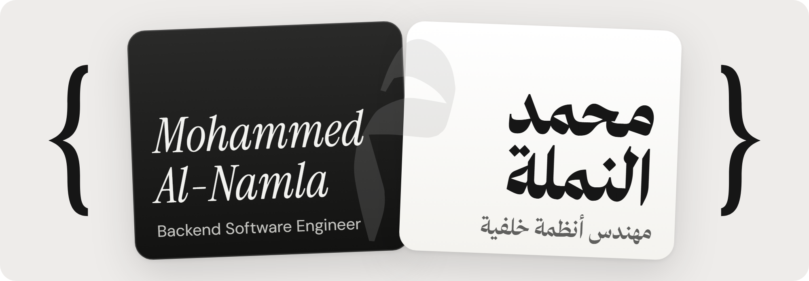

<a href="https://mohammed-alnamla.vercel.app">
  <picture>
    <source media="(prefers-color-scheme: dark)" srcset="assets/banner-dark.png">
    <source media="(prefers-color-scheme: light)" srcset="assets/banner-light.png">
    
  </picture>
</a>

  <a href="https://mohammed-alnamla.vercel.app">Website</a> ·
  <a href="https://www.linkedin.com/in/mohammed-al-namla">LinkedIn</a> ·
  <a href="https://mohammed-alnamla.vercel.app/Mohammed_Al_Namla_CV.pdf">CV</a> ·
  <a href="mailto:moh.alnamla@gmail.com">Email</a>

### Selected work

- **[RestroGram](https://mohammed-alnamla.vercel.app/#project-restrogram)** — Connects order taking, checkout, kitchen screens and stock control.
- **[BookForMe](https://mohammed-alnamla.vercel.app/#project-bookforme)** — Online bookings, calendars, clients and reports for service businesses.
- **[Taskat](https://mohammed-alnamla.vercel.app/#project-taskat)** — Backlog, sprints, Kanban boards and chat for software teams.
- **[Edux](https://mohammed-alnamla.vercel.app/#project-edux)** — A space for administrators, teachers and students.
- **[University of Palestine](https://mohammed-alnamla.vercel.app/#project-uop)** — News, events, exams and pages in several languages.
- **[NetSpeed](https://mohammed-alnamla.vercel.app/#project-netspeed)** — Prepaid cards, loyalty points, support tickets and field work.
